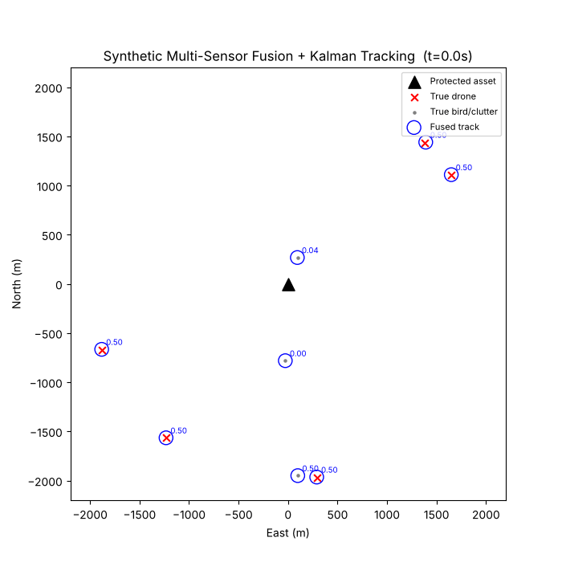

# Counter-Swarm Fusion Engine

### Synthetic Multi-Sensor Simulator and Kalman Tracker

A self-contained prototype of a SAPIENT-aligned multi-sensor fusion and tracking engine for counter-drone (C-UAS) systems. The project generates a synthetic drone swarm scenario, simulates noisy multi-sensor observation using radar, passive RF, and EO camera models, fuses cross-sensor detections, tracks objects over time with a Kalman filter, and produces a threat score per track. All of this is exposed through a live API with a browser-based real-time visualization.

This project is scoped intentionally as a fusion software prototype. It does not contain sensor design, jamming, or interceptor logic. The goal is to demonstrate the architecture used by a real C-UAS fusion and command-and-control layer. See the Design Notes section below for details.

**Live site:** https://counter-swarm-fusion.fly.dev/ (interactive demo at `/demo/`: switch sensors off, add noise, show raw detections and ground truth).



## Quick Start

```bash
pip install -r requirements.txt

# Run the simulation. Produces outputs/tracking_demo.gif and outputs/metrics.json
python demo.py

# Fit the threat-score calibration, then benchmark over many random scenarios
python calibrate.py
python evaluate.py --seeds 40

# Run the live API and browser demo
uvicorn api:app --reload --port 8000
# Landing page: http://localhost:8000/   Interactive demo: http://localhost:8000/demo/
```

## System Overview

| Module | Responsibility |
|---|---|
| `simulator/targets.py` | Generates ground truth trajectories for a swarm of drones approaching a protected point, plus bird and clutter decoys with more erratic motion. |
| `simulator/sensors.py` | Models three synthetic sensors (radar, passive RF, EO camera). Each sensor observes the ground truth at every timestep with its own noise profile, detection probability, false alarm rate, range limit, and classification capability. |
| `tracker/kalman.py` | Implements a constant-velocity Kalman filter for each track. |
| `tracker/association.py` | Performs gated nearest-neighbor data association using the Hungarian algorithm with Mahalanobis-distance gating. Described as "JPDA-lite" since it commits to a single best global assignment rather than maintaining full probabilistic hypotheses. |
| `tracker/track_manager.py` | Fuses same-instant cross-sensor detections that are spatially close (mirroring SAPIENT's `associated_detection` and `derived_detection` relationship). Associates fused detections to existing tracks. Updates each track's Kalman filter. Maintains track lifecycle states (TENTATIVE, CONFIRMED, DROPPED). |
| `demo.py` | Runs the full pipeline. Renders an animated visualization. Computes tracking and classification metrics. |
| `api.py` | Serves a FastAPI backend exposing live track state. Mirrors how a real fusion engine would sit behind an API consumed by a downstream C2 system or effector integrator. |
| `static/index.html` | A browser-based live demo that polls the API and renders tracks on a canvas in real time. |

## Results

Representative run: 5 drones and 3 decoys over a 120 second scenario.

| Metric | Value |
|---|---|
| True threats in final frame | 5 |
| Confirmed tracks in final frame | 8 |
| Total tracks in final frame | 9 |
| Mean threat score on real drones | 1.00 |
| Mean threat score on real decoys | 0.17 |

Drones score near 1. The decoy mean is above zero because one decoy track had no classification votes at the final frame and so scores 0.5 (unknown) rather than 0. Nine tracks formed for eight true targets is close to ideal. This is one run; see the Benchmark section for statistics over many.

## Benchmark

Single runs can be cherry-picked, so `evaluate.py` runs 40 random scenarios per condition (120 s each, 3 decoys, same seeds across conditions). At every step, confirmed tracks are matched to ground-truth targets with the Hungarian algorithm (50 m gate). Ground truth is used for scoring only, never by the tracker. Full results with standard deviations are in `outputs/benchmark.json` and on the live site.

### Tracking

Cells show the original tracker → **current tracker** (original results in `outputs/benchmark_v1.json`).

| Condition | Recall | Position RMSE (m) | ID switches / target | False tracks / step |
|---|---|---|---|---|
| 5 drones, 3 decoys, all sensors | 98.7% | 7.0 → **5.5** | 0.06 → **0.07** | 0.017 → **0.011** |
| 3 drones | 99.0% | 7.6 → **6.0** | 0.10 → **0.04** | 0.022 → **0.006** |
| 8 drones | 98.7% | 6.7 → **5.4** | 0.08 → **0.05** | 0.031 → **0.008** |
| 12 drones | 98.5% | 6.5 → **5.4** | 0.23 → **0.09** | 0.087 → **0.008** |
| No radar | 69.6% | 9.6 → **8.9** | 0.31 → **0.33** | 0.052 → **0.046** |
| No RF | 98.6% | 6.7 → **5.8** | 0.04 → **0.02** | 0.001 → **0.001** |
| No camera | 98.7% | 7.1 → **6.0** | 0.17 → **0.08** | 0.037 → **0.011** |
| Radar only | 98.7% | 6.9 → **6.3** | 0.03 → **0.02** | 0.000 → **0.000** |
| 2x sensor noise | 98.7% | 13.3 → **9.2** | 12.29 → **0.32** | 4.997 → **0.060** |
| 3x sensor noise | 98.5% | 20.0 → **12.5** | 18.52 → **0.29** | 8.562 → **0.080** |
| 70% detection probability | 97.7% | 7.8 → **6.4** | 0.33 → **0.28** | 0.021 → **0.004** |
| 50% detection probability | 93.4% | 8.7 → **7.5** | 1.69 → **1.65** | 0.015 → **0.003** |
| Uninformative classifier confidence | 98.7% | 5.5 | 0.03 | 0.003 |

What the numbers say:

- **Per-detection measurement noise was the main fix.** The original tracker assumed one fixed noise level for every detection. Carrying each detection's own noise through fusion, gating and the Kalman update cut ID switches at 2x noise from 12.3 to 0.3 per target and false tracks from 5.0 to 0.06 per step, and lowered position error in every condition.
- **Radar is the acquisition sensor.** Without it, recall falls to about 70% and the first confirmed track takes roughly 28 s instead of about 1 s, because RF and camera range is shorter than where the drones start.
- **Not fixed: missed detections.** At 50% detection probability there are still about 1.7 fragmentations per target. That needs track coasting and M-of-N confirmation.

### Threat score

The score is now a calibrated P(drone): each classification vote is converted to a likelihood ratio fitted from labelled trials (held-out seeds 1001-1030, per sensor type and reported-confidence bin) and combined by sequential Bayes. A track with no votes scores 0.5 instead of 0. Cells show the original score → **new score**, measured at every step on tracks with at least one vote.

| Condition | Brier | Calibration error (ECE) | Wrong when ≥90% sure | Time to settle ≥90% (s) |
|---|---|---|---|---|
| 5 drones, 3 decoys, all sensors | 0.0047 → **0.0005** | 0.0038 → **0.0018** | 0.21% → **0.00%** | 27 → **27** |
| No RF | 0.0021 → **0.0007** | 0.0025 → **0.0020** | 0.04% → **0.00%** | 64 → **65** |
| 2x sensor noise | 0.0053 → **0.0009** | 0.0041 → **0.0016** | 0.25% → **0.04%** | 29 → **29** |
| 50% detection probability | 0.0136 → **0.0021** | 0.0105 → **0.0026** | 0.61% → **0.04%** | 36 → **29** |
| Uninformative classifier confidence | 0.0121 → **0.0107** | 0.0108 → **0.0127** | 0.82% → **0.18%** | 29 → **45** |

What the numbers say:

- **The original score was not badly overconfident on the baseline simulator.** The simulated sensors report higher confidence when they are right, so a naive score that trusts the confidence value does well. The new score gains mostly by learning that relationship from data, so treat the baseline improvement with caution.
- **The realistic test is the last row**, where reported confidence says nothing about correctness. There the original score is wrong while 90% sure 0.82% of the time versus 0.18% for the new one, and Brier improves slightly. Calibration error is about the same, and the new score takes longer to settle (45 s versus 29 s) because it commits less eagerly.
- **These are simulator results.** The calibration data comes from the same simulator, so they show the method works, not how it would perform on real sensors, where classifier errors are also correlated over time.

Reproduce with `python calibrate.py` then `python evaluate.py --seeds 40` (about 8 minutes on one core).

## Design Notes: Alignment with the SAPIENT Standard

This project mirrors the semantics of the real SAPIENT Interface Control Document (DSTL/PUB145591) rather than introducing an ad hoc data model.

**Detection, fusion, and track are treated as three distinct relationships.** A `DetectionReport` represents one sensor's instantaneous report. Fusion combines same-instant cross-sensor detections through the `associated_detections` and `derived_detections` fields defined in `schema.py`. A track is a time series of fused detections sharing a single `object_id` or `track_id`. Conflating these three concepts is a common architectural error in fusion systems. This codebase keeps them separate by design.

**Each sensor declares its own capability profile.** Every `SyntheticSensor` instance declares its detection probability, false alarm rate, location error, and classification capability. This mirrors SAPIENT's Registration message, in which each node reports only the fields its specific capability profile supports.

**Track lifecycle states model operator trust.** The TENTATIVE, CONFIRMED, and DROPPED states mirror how a real Decision Making Module manages track confidence before recommending an engagement response.

## Known Limitations

These limitations are documented intentionally as a record of engineering tradeoffs rather than omissions to be hidden.

**Classification calibration is only as good as the labelled data behind it.** The likelihood ratios are fitted on simulated trials, so they match the simulator by construction. Real classifier errors are correlated over time (the same bird keeps looking like a drone), which this model does not capture and which would make repeated votes less independent than assumed.

**The motion model assumes constant velocity.** Real drones maneuver. An Interacting Multiple Model filter blending constant-velocity and constant-acceleration or coordinated-turn models would track maneuvering targets more accurately.

**Data association uses greedy nearest-neighbor assignment rather than full JPDA.** Under dense swarms with overlapping gates, a probabilistic data association approach would handle ambiguous assignments more gracefully than committing to a single global least-cost assignment at every timestep.

**Track fragmentation under missed detections.** Duplicate suppression now scales with measurement noise, which fixed fragmentation under noise, but at low detection probability tracks still break and restart. Coasting and M-of-N confirmation are the principled fix.

## Next Steps

1. Add a coasting state and M-of-N track confirmation to reduce fragmentation at low detection probability.
2. Add temporally correlated classifier errors to the simulator and calibrate against recorded sensor data.
3. Add maneuvering targets to the simulator, then an Interacting Multiple Model filter.
4. Move from gated nearest-neighbor association to full JPDA or a multi-hypothesis tracker for dense swarm scenarios.
5. Replace the synthetic sensors with adapters that speak the real SAPIENT Protobuf wire format. The official `.proto` definitions can be requested from the SAPIENT Interface Management Panel at SAPIENT@dstl.gov.uk.
6. Extend the live demo to a WebSocket-based architecture so the server pushes track updates rather than the client polling for them.

## License

This project is released under the MIT License.
